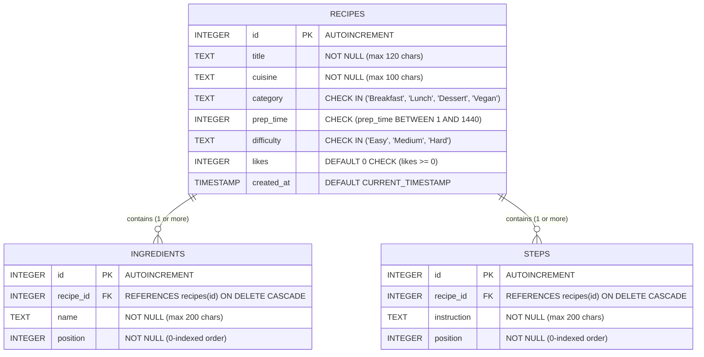
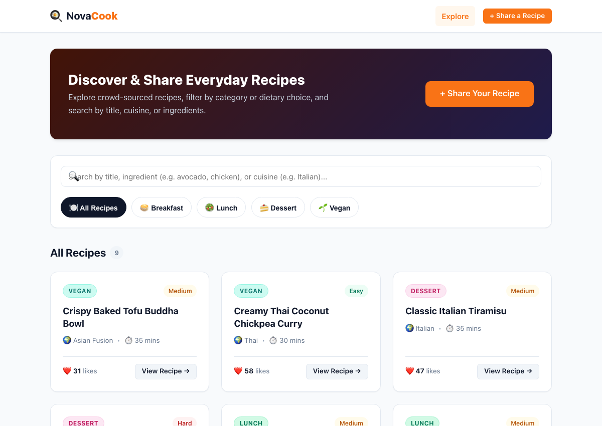
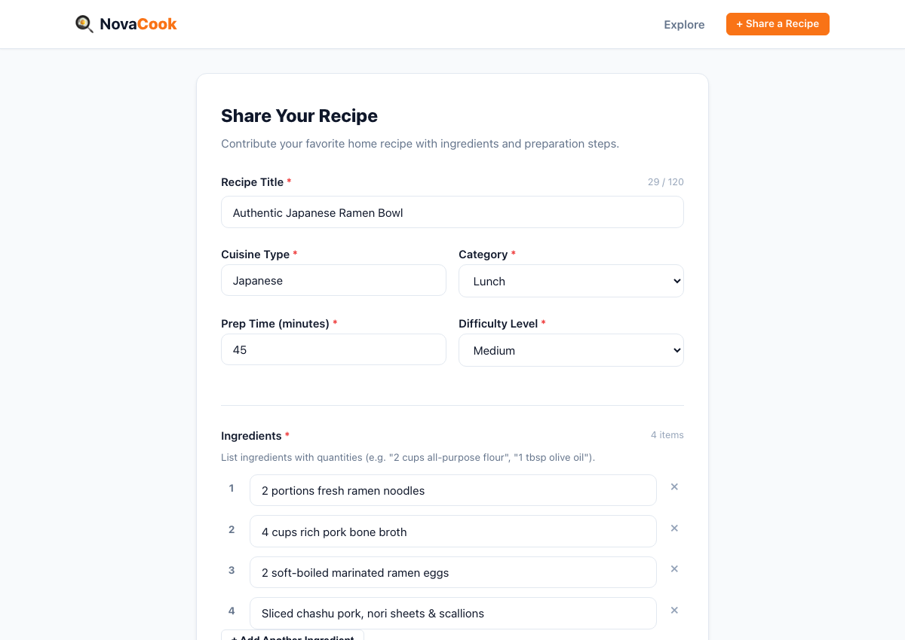
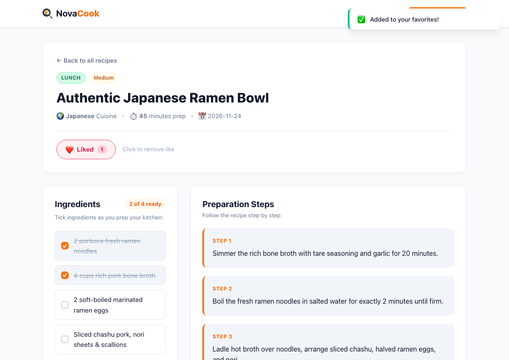
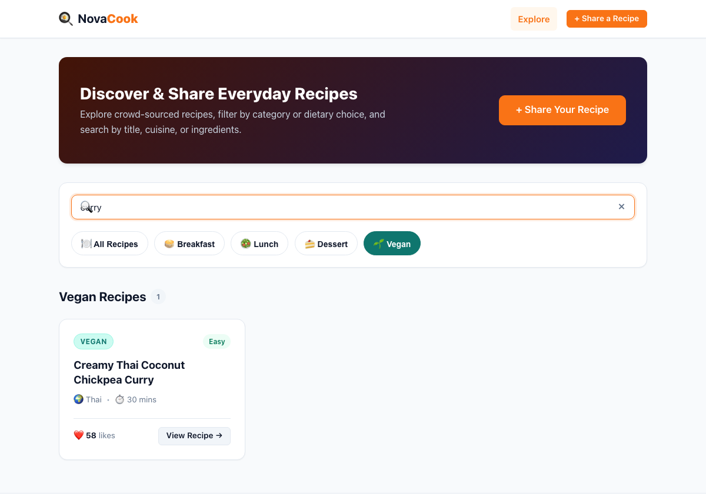
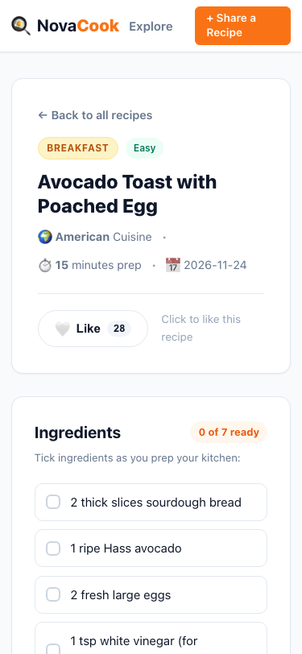

# Community Recipe Sharing Platform

[](https://www.python.org/downloads/release/python-396/)
[](https://flask.palletsprojects.com/)
[](https://www.sqlite.org/)
[](LICENSE)

A modern, responsive Community Recipe Sharing web application built for the **CodeNova Full Stack Development Internship (Batch 02, Task 4)**. Discover and share home-cooked meals, filter by categories and dietary preferences, perform real-time debounced searches across ingredients and cuisines, tick off interactive ingredient preparation checklists, and like recipes with instant client and database synchronization.

Built strictly with 100% free, standard tools: Python 3.9, Flask, built-in SQLite3, and vanilla HTML5, CSS3, and JavaScript with **zero build step and zero npm dependencies**.

---

## Table of Contents
1. [Key Features](#key-features)
2. [Tech Stack](#tech-stack)
3. [Architecture Overview & Folder Structure](#architecture-overview--folder-structure)
4. [Database Schema](#database-schema)
5. [Interactive Features & Client-Server Synchronization](#interactive-features--client-server-synchronization)
6. [REST API Reference](#rest-api-reference)
7. [Local Development Setup](#local-development-setup)
8. [Seed Data](#seed-data)
9. [Deployment Guide (Render Free Tier)](#deployment-guide-render-free-tier)
10. [Screenshots](#screenshots)

---

## Key Features

- **Explore Feed & Recipe Grid**: Responsive card grid showcasing recipe title, color-coded category tags, cuisine origin, preparation time, difficulty badges, and community like counters.
- **Instant Category Filtering**: Filter recipes on the fly across **All**, **Breakfast**, **Lunch**, **Dessert**, and **Vegan** using chips without a page reload.
- **Reactive Debounced Search**: 300ms debounced search bar dynamically querying across recipe titles, cuisine types, and ingredient keywords simultaneously via `fetch()`. Category filtering and keyword search work seamlessly together.
- **Dynamic Recipe Publishing**: Interactive form allowing creators to input recipe details and dynamically add or remove ingredient rows and ordered preparation steps with front-end validation. Wrapped in an atomic SQLite transaction on the server.
- **Interactive Ingredient Checklist**: Dynamic checklist on the recipe detail page allowing cooks to tick off ingredients as they prep. Includes a real-time progress counter (*"3 of 8 ready"*) and strikethrough styling saved in the browser session.
- **Persistent Like Counter**: Like/favorite heart button with instant optimistic UI feedback. Uses `localStorage` to prevent duplicate likes from the same browser while allowing users to toggle their like status back to unlike. The backend atomically updates SQLite counts and guarantees likes never drop below zero.
- **XSS-Safe & Accessible Design**: All user data is rendered securely via `textContent` and escaped template variables to prevent cross-site scripting. Uses non-blocking toast notifications (no browser `alert()`).
- **Mobile-First Responsive Layout**: Engineered with CSS flexbox and grid, tested and verified on 360px mobile viewports through large desktop screens.

---

## Tech Stack

| Layer | Technology | Details |
|---|---|---|
| **Backend** | Python 3.9.6, Flask 3.0.3 | Minimalistic REST API + Jinja2 server-rendered views |
| **Database** | SQLite3 (Built-in) | Relational schema with foreign keys enabled (`PRAGMA foreign_keys=ON`) |
| **Configuration** | `python-dotenv 1.0.1` | Environment-based configuration via `.env` |
| **Production WSGI** | `gunicorn 22.0.0` | Production WSGI HTTP server |
| **Frontend** | Vanilla HTML5, CSS3, JavaScript | Zero build step, zero npm, modern responsive UI |

---

## Architecture Overview & Folder Structure

```
community-recipe-platform/
├── app.py                 # Flask application factory, web routes, REST API, error handlers
├── db.py                  # SQLite connection helper, foreign key enforcer, init helpers
├── schema.sql             # Relational table definitions, foreign keys, cascade deletes, indexes
├── seed.py                # Idempotent seed script inserting 9 authentic sample recipes
├── capture_and_verify.py  # Automated Playwright test and screenshot capture script
├── requirements.txt       # Pinned production dependencies (Flask, python-dotenv, gunicorn)
├── Procfile               # Deployment entrypoint (web: gunicorn app:app)
├── .env.example           # Template for environment variables
├── .env                   # Local environment configuration (ignored by Git)
├── .gitignore             # Ignores .env, *.db, venv/, __pycache__/
├── README.md              # Comprehensive project documentation
├── static/
│   ├── css/
│   │   └── style.css      # Mobile-first CSS, custom variables, category color themes
│   └── js/
│       └── app.js         # Debounced search (300ms), category filter, checklist counter, like toggle
├── templates/
│   ├── base.html          # Shared layout, navbar ("Explore", "Share a Recipe"), toast container
│   ├── index.html         # Explore feed, category filter chips, live search bar, recipe grid
│   ├── create.html        # Dynamic form (ingredients & steps adder/remover)
│   └── recipe.html        # Recipe detail view (interactive checklist, numbered steps, like button)
└── screenshots/           # Verification screenshots
    ├── 01-explore-feed.png
    ├── 02-create-recipe-form.png
    ├── 03-recipe-detail.png
    ├── 04-search-filter-results.png
    └── 05-mobile-view.png
```

---

## Database Schema

The database leverages SQLite's relational integrity with foreign keys enabled (`PRAGMA foreign_keys = ON;`).



### Constraints & Indexes
- Foreign key constraints ensure that when a recipe is deleted, its associated ingredients and steps are removed via cascading deletes (`ON DELETE CASCADE`).
- Explicit ordered integer columns (`position`) preserve the author's intended recipe sequence.
- Optimized indexes: `idx_ingredients_recipe_id`, `idx_steps_recipe_id`, `idx_recipes_category`, `idx_recipes_title`.
- Atomic transactions: creating a recipe inserts the parent record along with all ingredient and step rows inside a single database transaction.

---

## Interactive Features & Client-Server Synchronization

### 1. Debounced Search & Category Filter
- **300ms Debounce**: As the user types in the search bar, input events are debounced by 300 milliseconds before issuing a `fetch()` request to `/api/recipes?category=...&q=...`.
- **Compound Querying**: Search queries and category chips operate simultaneously. For example, selecting `Vegan` and typing `curry` immediately isolates the *Thai Coconut Chickpea Curry*.
- **Full Text Search**: The query matches recipe titles, cuisine names, and any ingredient name via SQL `LIKE` matching.

### 2. Interactive Ingredient Checklist
- Cooks can tick off ingredients on the detail page as they prepare ingredients.
- A live badge tracks preparation progress (*"3 of 8 ready"*), turning green when all ingredients are completed.
- Checkbox states are stored in browser session storage (`sessionStorage`), allowing cooks to refresh or navigate without losing their preparation progress. A "Reset Checklist" button allows clearing selections.

### 3. Persistent Like & Favorite Toggle
- **Optimistic UI Update**: Clicking the like heart immediately toggles the active state and updates the visible counter.
- **Duplicate Prevention**: A list of liked recipe IDs is stored in `localStorage` under `codenova_liked_recipes`. If already liked, clicking again initiates an `unlike` action.
- **Server Consistency**: The server validates the action (`like` or `unlike`), increments or decrements the count atomically, and ensures `likes = MAX(0, likes - 1)`.

---

## REST API Reference

All API routes return JSON and are grouped under `/api`.

| Method | Endpoint | Query / Body Params | Success Response | Error Responses | Description |
|---|---|---|---|---|---|
| `GET` | `/api/recipes` | `category` (optional)<br>`q` (optional keyword) | `200 OK`<br>`[{id, title, cuisine, category, prep_time, difficulty, likes, created_at}, ...]` | `500 Internal Error` | List recipes with optional category and search filter |
| `GET` | `/api/recipes/<id>` | *None* | `200 OK`<br>`{id, title, cuisine, category, prep_time, difficulty, likes, ingredients: [...], steps: [...]}` | `404 Not Found` | Fetch complete recipe details with ordered items |
| `POST` | `/api/recipes` | Body: `{title, cuisine, category, prep_time, difficulty, ingredients: [..], steps: [..]}` | `201 Created`<br>`{id: 10, title: "...", message: "..."}` | `400 Bad Request`<br>Missing/invalid field<br>`500 Database Error` | Create a new recipe in a single atomic transaction |
| `POST` | `/api/recipes/<id>/like` | Body: `{action: "like" \| "unlike"}` | `200 OK`<br>`{id: 1, likes: 29, action: "like", message: "..."}` | `400 Bad Request`<br>Invalid action<br>`404 Not Found` | Increment or decrement like count (minimum 0) |

### Server-Side Validation Rules
- **Title**: String, required, stripped of whitespace, minimum 1 character, maximum 120 characters.
- **Cuisine**: String, required, stripped of whitespace, maximum 100 characters.
- **Category**: Required, must strictly be one of `'Breakfast'`, `'Lunch'`, `'Dessert'`, or `'Vegan'`.
- **Prep Time**: Integer, required, between 1 and 1440 minutes (24 hours).
- **Difficulty**: Required, must strictly be one of `'Easy'`, `'Medium'`, or `'Hard'`.
- **Ingredients**: Array of strings, at least 1 item required. Each item non-empty and maximum 200 characters.
- **Steps**: Array of strings, at least 1 item required. Each item non-empty and maximum 200 characters.

---

## Local Development Setup

### Prerequisites
- macOS or Linux
- Python 3.9+ (tested on Python 3.9.6)
- Git

### Step-by-Step Instructions

1. **Clone the repository**:
   ```bash
   git clone <your-repo-url>
   cd community-recipe-platform
   ```

2. **Create and activate a virtual environment**:
   ```bash
   python3 -m venv venv
   source venv/bin/activate
   ```

3. **Install dependencies**:
   ```bash
   pip install -r requirements.txt
   ```

4. **Configure environment variables**:
   ```bash
   cp .env.example .env
   ```

5. **Initialize database & seed sample data**:
   ```bash
   python seed.py
   ```
   *The seed script creates the SQLite tables if needed and loads 9 authentic sample recipes across all 4 categories. It is completely safe to run multiple times (idempotent).*

6. **Start the application**:
   ```bash
   python app.py
   ```
   *Or using Flask CLI:*
   ```bash
   flask --app app run --port 5000
   ```

7. **Open in browser**:
   Navigate to [http://127.0.0.1:5000](http://127.0.0.1:5000)

---

## Seed Data

Running `python seed.py` provisions the database with 9 authentic sample recipes covering all four categories:
1. *Avocado Toast with Poached Egg* (Breakfast, American, 15m, Easy)
2. *Fluffy Blueberry Buttermilk Pancakes* (Breakfast, American, 25m, Easy)
3. *Mediterranean Quinoa Power Bowl* (Lunch, Mediterranean, 25m, Easy)
4. *Classic Margherita Pizza* (Lunch, Italian, 40m, Medium)
5. *Creamy Tuscan Chicken Pasta* (Lunch, Italian, 30m, Medium)
6. *Molten Chocolate Lava Cake* (Dessert, French, 25m, Hard)
7. *Classic Italian Tiramisu* (Dessert, Italian, 35m, Medium)
8. *Creamy Thai Coconut Chickpea Curry* (Vegan, Thai, 30m, Easy)
9. *Crispy Baked Tofu Buddha Bowl* (Vegan, Asian Fusion, 35m, Medium)

The seed script checks for existing recipe titles before inserting, making it completely safe to run repeatedly without creating duplicates.

---

## Deployment Guide (Render Free Tier)

This platform is configured for instant deployment on [Render](https://render.com) Web Services.

### 1. Build and Start Settings
- **Environment**: Python
- **Build Command**:
  ```bash
  pip install -r requirements.txt && python seed.py
  ```
- **Start Command**:
  ```bash
  gunicorn app:app
  ```
  *(Specified in the included `Procfile`)*

### 2. Environment Variables on Render
Add the following in your Render service's **Environment** tab:
| Key | Sample Value | Note |
|---|---|---|
| `SECRET_KEY` | `generate-a-strong-random-secret` | Flask session signing |
| `DATABASE_PATH` | `recipes.db` | Relative path to SQLite file |
| `FLASK_ENV` | `production` | Production environment mode |

> [!WARNING]
> **Ephemeral Storage Notice on Render Free Tier**:
> Render's free Web Service tier operates on ephemeral storage. Any changes to the SQLite database (`recipes.db`) will reset whenever the free instance spins down due to inactivity or restarts upon a new deployment. For persistent production storage, attach a Render Persistent Disk (available on paid plans) or connect to an external hosted PostgreSQL instance.

---

## Screenshots

### 1. Explore Feed
Responsive card grid with search bar, category chips, prep times, and difficulty badges:


---

### 2. Recipe Creation Form
Dynamic form with input validation and add/remove buttons for ingredients and steps:


---

### 3. Recipe Detail Page
Interactive ingredient checklist with live progress counter, numbered steps, and persistent like button:


---

### 4. Search & Category Filter Results
Debounced reactive search filtering by Vegan category and keyword "curry":


---

### 5. Mobile View (375px)
Fluid responsive layout optimized for mobile screens:


---

## License

This project is licensed under the MIT License. Developed for the CodeNova Internship Program (Batch 02, Task 4).
